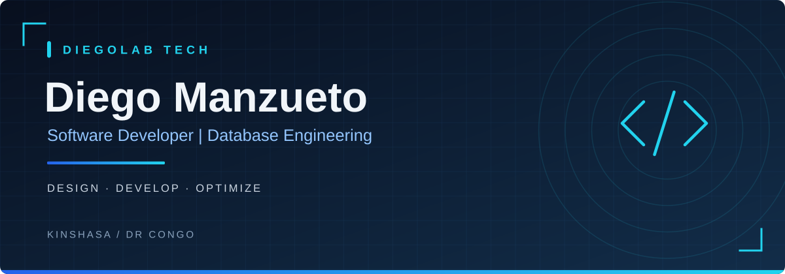

**Software Engineering · Information Systems · Data Solutions**

---

## 01 — About Me

I am a software developer with a background in Information Systems 
Design and Development.

My interests include software engineering, database engineering,
business process automation and data analytics.

I focus on designing structured, reliable and maintainable 
digital solutions that address real-world business needs.

## 02 — Technical Expertise

### Software Engineering

### Database Engineering

### Data Analytics & Business Intelligence

### Development Tools

## 03 — Core Competencies

- Information Systems Analysis and Design
- Relational Database Design
- SQL Development and Query Optimization
- Desktop and Web Application Development
- REST API Development
- Business Intelligence and Reporting
- Software Documentation

## 04 — Currently Learning

- MongoDB and NoSQL databases
- Advanced SQL Server Administration
- Software Architecture
- ASP.NET Core Web APIs

## 05 — Engineering Philosophy

> Understand the problem. Design the solution.
> Build with precision. Improve continuously.

---

**DIEGOLAB TECH**

Design · Develop · Optimize

