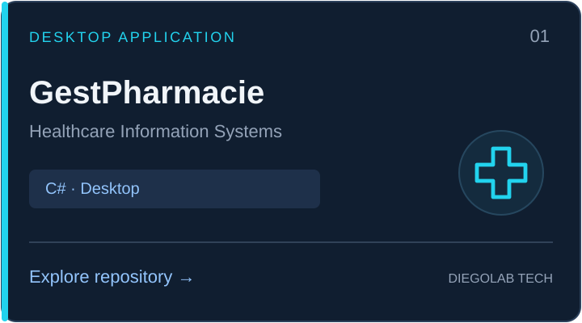
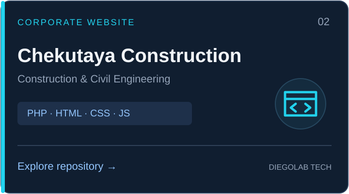
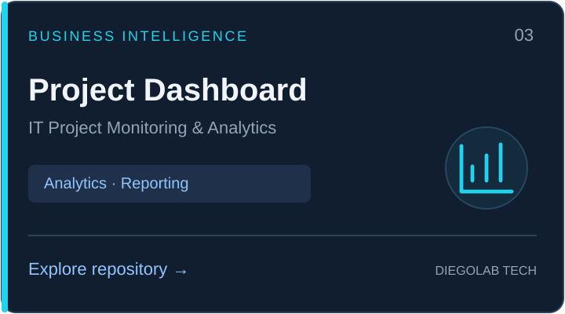
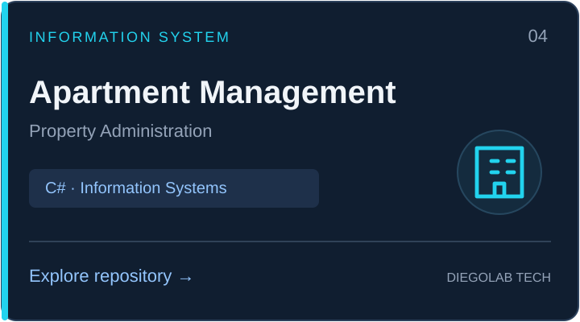

**Software Engineering · Information Systems · Data Solutions**

---

## 01 — About Me

I am a software developer with a background in Information Systems 
Design and Development.

My interests include software engineering, database engineering,
business process automation and data analytics.

I focus on designing structured, reliable and maintainable 
digital solutions that address real-world business needs.

## 02 — Technical Expertise

### Software Engineering

  

### Backend & API Development

### Database Engineering

  

### Web Development

  

### Data Analytics & Business Intelligence

### Development Tools & Version Control

  

## 03 — Featured Projects

A selection of my software engineering, information systems
and business intelligence projects.

 

---

## 04 — Currently Learning

- MongoDB and NoSQL databases
- Advanced SQL Server Administration
- Software Architecture
- ASP.NET Core Web APIs

## 05 — GitHub Analytics

A visual overview of my development activity and technical contributions.

  
  

  

---

**DIEGOLAB TECH**

Design · Develop · Optimize

